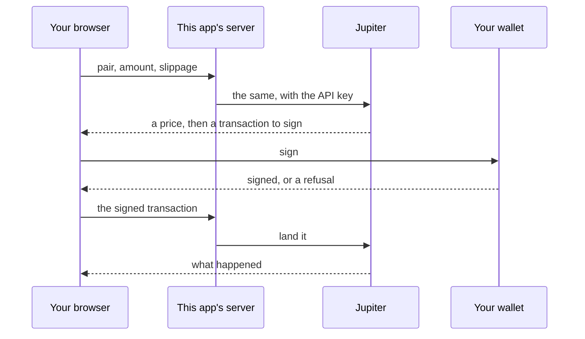

# Solana B4 Jupiter swap page

A Next.js page that gets a live price from Jupiter, has the trader's wallet sign once, and swaps one Solana token for another. Whatever happens next, the page says which: completed, rejected, expired, slippage exceeded, failed, or not confirmed.

This is Deed #4 of The Solana Deeds, a series of one-day learning builds. [Read the write-up](https://reddi.tech/blog/solana-b4-jupiter-swap) and [watch the demo](https://youtu.be/gBrxAh3iwLk).

This is a source snapshot of `f7660d5f4a4c28ef4c19951207a3a85ddfc4f9af`; the first snapshot was of `bc57186c50fa5f678c6ea2f394d5fa65c03f1b70`. The private build journal, issue history and evidence files are not part of this repository.

## Run it

Install [mise](https://mise.jdx.dev), then:

```sh
mise install
cd app
export PATH="$(mise where node)/bin:$(mise where pnpm):$PATH"
pnpm install --frozen-lockfile
pnpm run ci                        # build, typecheck, lint, format check, 53 tests
JUPITER_API_KEY=... pnpm dev       # http://localhost:3000
```

The tests need no API key, network or funds. To get quotes you need a free API key from the [Jupiter developer platform](https://developers.jup.ag). Pass it in the environment. It is read by the server only; never put it in a `NEXT_PUBLIC_` variable or commit it.

The project refuses any Node other than 22.x, which is why the `PATH` line is there.

**Swapping on this page moves real funds.** Jupiter only routes on mainnet. Use an amount you can afford to lose and read your wallet's preview before approving.

## How it works



- `app/app/api/jupiter/` and `app/app/lib/jupiter-server.ts`: two server routes that hold the key, accept only five listed tokens, whole-number amounts, slippage from 1 to 1000 basis points and a valid wallet address, and forward to Jupiter Swap API v2 (`/order` and `/execute`).
- `app/app/lib/hooks/use-quote.ts`: a quote that refreshes every 10 seconds and is withdrawn after 30 seconds without a refresh.
- `app/app/lib/hooks/use-swap.ts`: fresh order, one wallet signature, execute. If the answer is lost after signing, it asks again about the same signed transaction and never signs twice.
- `app/app/lib/find-landed.ts`: for a gasless order, where the fee payer signs inside `/execute` and the page never has the transaction ID. If the answer is lost, it searches the wallet's 20 newest transactions for one carrying the wallet's own signature. It reports "did not go through" only when every transaction was read and the chain is past the order's last valid block height; anything less certain stays "not confirmed". Added after [a reply on X](https://x.com/0xeddiekim/status/2124150538074005509) pointed out the gap.
- `app/app/lib/jupiter.ts`: maps Jupiter's response codes to the outcomes the page names.

`app/README.md` has the full file map.

## What was actually proven

- One real swap on mainnet, 0.01 SOL for 0.684945 USDC, [finalized](https://explorer.solana.com/tx/2YLqhcJaGArs3aGARqb7FFW4MouCr9UMq437cg3ouD41LM1FAmUoEC5181pkftqX9jiFg9iC5e2Lswzxxw9eh1Va). `pnpm run reproduce` (with the app running) reads it back from the chain and checks the amounts.
- One real rejection in the wallet, shown in the demo video.
- The expired, slippage-exceeded, failed and not-confirmed outcomes are covered by tests only. Those tests use a mock wallet, and the `/execute` answers in them are written from Jupiter's documentation, not captured from real swaps. The files in `app/tests/fixtures/` are real `/order` responses.
- The gasless search is covered by tests only, with RPC answers written for the tests. It has not run against the chain.

## Limits

- A learning build. No audit, no hosted deployment, no rate limiting beyond Jupiter's own.
- The page asks the wallet to sign the transaction Jupiter returns without decoding it first. The wallet's preview is the check.
- "Slippage exceeded" is recognised by Jupiter program error 6001 or the word "slippage" in the error. A venue that reports it another way shows as a generic failure with its code.
- The balance in the header and the gasless search read the public mainnet RPC, which may refuse browser requests. A refused search leaves the swap "not confirmed". Swapping does not depend on the RPC.
- A wallet that can only sign-and-send in one step is refused, because Jupiter's managed execution needs the signed transaction back.
- The page does not check the trader's balance before quoting.

## Licence

MIT. See [LICENSE](LICENSE).
